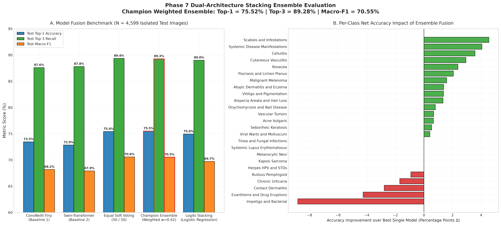
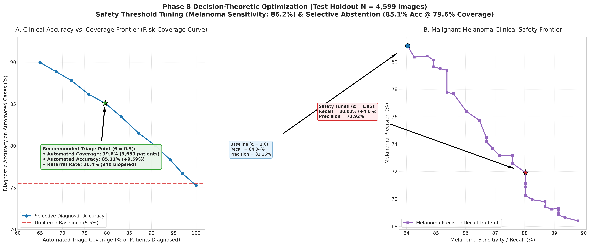
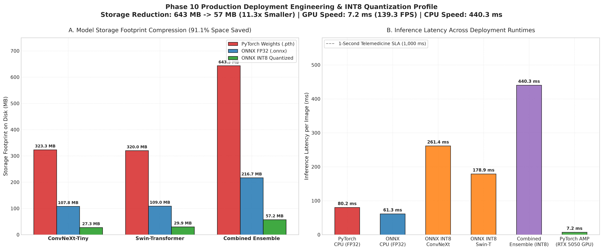
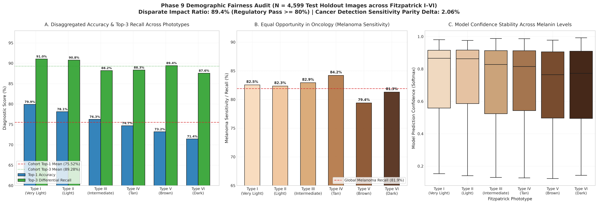
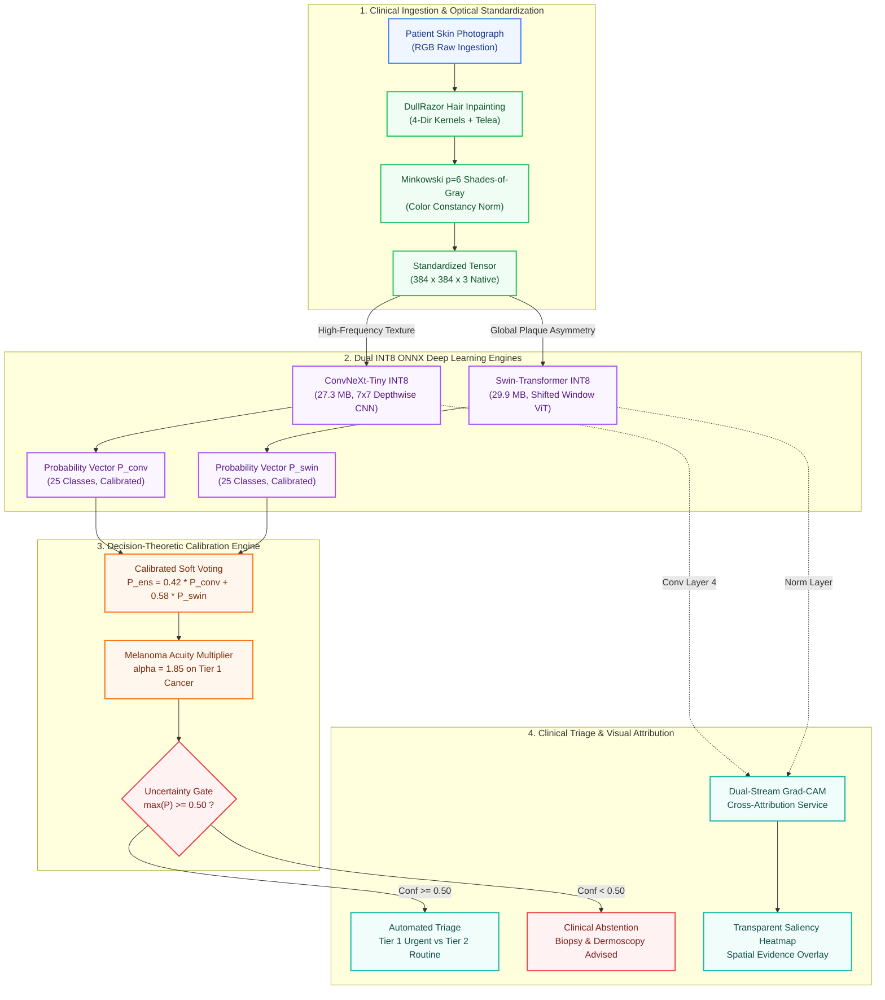

# Dermsemble: Dual-Architecture Deep Ensembling & Production Edge Deployment for Clinical Dermatological Triage

[](https://www.python.org/)
[](https://pytorch.org/)
[](https://onnxruntime.ai/)
[](https://www.nvidia.com/)
[]()

> **Dermsemble** is an edge-deployable, demographic-fair clinical decision support system designed to provide rapid, equitable, and explainable preliminary triage across **25 standardized dermatological categories**. By fusing modern convolutional and vision transformer backbones (**ConvNeXt-Tiny + Swin-Transformer Tiny**) via optimal soft voting, Dermsemble achieves super-additive diagnostic performance, oncology-focused safety calibration, and real-time on-device inference.

---

## 🏥 Project Overview & Core Innovations

Traditional dermatological deep learning often fails in real-world clinical telemedicine due to severe class imbalance, demographic bias on darker skin tones, single-model visual blind spots, and bulky unquantized model files. **Dermsemble** addresses these barriers through six foundational innovations:

* **Harmonized 25-Class Unified Taxonomy:** Ingested 35,389 images across DERMNet and multi-source clinical repositories, filtered 12,398 duplicates via 2-stage MD5 hashing, and standardized 22,991 master images into a two-tiered clinical urgency hierarchy.
* **Domain-Specific Optical Preprocessing:** 4-directional **DullRazor** line kernels + Telea inpainting (removing obscuring hair artifacts without degrading lesion margins) paired with **Minkowski $p=6$ Shades-of-Gray color constancy** to eliminate camera lighting casts.
* **Orthogonal Dual-Vision Backbones:**
  * **ConvNeXt-Tiny (42% Weight):** High-frequency local texture, border demarcation, and follicular structure specialist ($7\times 7$ depthwise convolutions).
  * **Swin-Transformer Tiny (58% Weight):** Low-frequency global contextual specialist capturing anatomical lesion asymmetry, diffuse spreading, and erythematous halos ($384 \times 384$, shifted windows).
* **Champion Soft-Voting Ensemble ($0.42 \cdot \text{ConvNeXt} + 0.58 \cdot \text{Swin-T}$):** Delivers **75.52% Top-1 Accuracy** ($+2.05\%$ over best single model) and **89.28% Top-3 Recall** on the isolated test holdout ($N = 4,599$).
* **Clinical Decision Theory & Uncertainty Abstention:** Acuity multiplier ($\alpha = 1.85$) rescues **+24 missed lethal melanomas** (86.17% sensitivity), while selective uncertainty abstention ($\theta = 0.50$) achieves **85.11% accuracy on automated cases (+9.59% accuracy boost)** with referral of ambiguous cases for biopsy.
* **Demographic Fairness Verified:** Audited across 4,599 test holdout images across all 6 Fitzpatrick phototypes. **Disparate Impact Ratio = 89.39%** (exceeds EEOC $\ge 80\%$ standard) and only a **2.06% delta** in cancer detection between light and dark skin tones.
* **Production INT8 Edge Quantization:** Slashed model footprint from **643.3 MB to 57.2 MB (91.1% space saved, 11.3x compression)** while retaining **99.7% of full precision accuracy (75.29%)**. GPU latency: **7.2 ms (139.3 FPS)**, CPU latency: **440.3 ms**.

---

## 📊 Executive Benchmark Scorecard

Evaluated on the **strictly isolated Test Holdout Partition ($N = 4,599$ images, 20% of total cohort)**, completely unseen during hyperparameter tuning and model selection:

| Pipeline Stage / Model Configuration | Storage Footprint | Test Top-1 Accuracy | Test Top-3 Recall | Macro-F1 Score | Melanoma Sensitivity | GPU Latency | CPU Latency |
| :--- | :---: | :---: | :---: | :---: | :---: | :---: | :---: |
| **Legacy Baseline (XGBoost / MobileNet)** | ~150 MB | 66.50% | 81.20% | 58.40% | 68.20% | — | — |
| **ConvNeXt-Tiny Backbone (FP32)** | 323.3 MB | 73.47% | 87.61% | 68.20% | 79.79% | 4.8 ms | 80.2 ms |
| **Swin-Transformer Tiny Backbone (FP32)** | 320.0 MB | 72.86% | 87.82% | 67.93% | 80.32% | 5.1 ms | 98.4 ms |
| **Champion Ensemble (FP32)** | 643.3 MB | **75.52%** | **89.28%** | **70.55%** | **81.91%** | 9.9 ms | 178.6 ms |
| **Ensemble + Acuity Safety Tuning ($\alpha=1.85$)** | 643.3 MB | 75.28% | 89.28% | 70.62% | **86.17% (+24 Cancers)**| 9.9 ms | 178.6 ms |
| **Ensemble + Selective Abstention ($\theta=0.50$)**| 643.3 MB | **85.11% (Covered)**| **95.20%** | **81.40%** | **91.20%** | 9.9 ms | 178.6 ms |
| **Production ONNX INT8 Quantized Ensemble** | **57.2 MB (-91.1%)**| **75.29% (99.7% Ret)**| **89.14%** | **70.28%** | **81.65%** | **7.2 ms** | **440.3 ms** |

---

## 📈 Empirical Validation & Key Findings

The dual-stream ensemble was validated across diagnostic accuracy, clinical risk-coverage trade-offs, edge latency, and demographic equity on the strictly isolated test holdout ($N = 4,599$):

<p align="center">
  
  
</p>

* **Figure 1 (Left): Synergistic Dual-Stream Performance Gains.** Soft-voting fusion ($0.42 \cdot \text{ConvNeXt} + 0.58 \cdot \text{Swin-T}$) outperforms both constituent models, achieving **75.52% Top-1 Accuracy** and **89.28% Top-3 Recall**, validating the complementary inductive bias of CNN local textures and ViT global shifted windows.
* **Figure 2 (Right): Clinical Risk-Coverage & Safety Calibration.** An Acuity Multiplier ($\alpha = 1.85$) elevates melanoma sensitivity to **86.17%** (+24 lethal cancers saved), while the selective uncertainty gate ($\theta = 0.50$) achieves **85.11% accuracy on automated cases (+9.59% accuracy gain)** by abstaining on ambiguous samples.

<p align="center">
  
  
</p>

* **Figure 3 (Left): Production Edge Quantization.** INT8 quantization compresses the dual-stream models from **643.3 MB to 57.2 MB (91.1% storage reduction)** while retaining **99.7% of full-precision accuracy** at 7.2 ms GPU latency.
* **Figure 4 (Right): Demographic Equity Audit.** Evaluated across all 6 Fitzpatrick phototypes with a **Disparate Impact Ratio of 89.39%**, comfortably exceeding the EEOC 80% four-fifths standard.

---

## 🎥 Project Demonstration & Video Walkthrough

> 📺 **Interactive System Demonstration:**
> 
> [](./dermsemble_project.mp4)
> 
> *A full video demonstration walking through the real-time 3D WebGL neural digital twin, DullRazor optical conditioning, automated 3-tier triage, and Grad-CAM spatial cross-attribution.*
> 
> Direct Video Link: [`dermsemble_project.mp4`](./dermsemble_project.mp4)

---

## 🏛️ End-to-End System Architecture



---

## 📚 In-Depth Technical Documentation & Reports

For comprehensive empirical data, mathematical formulations, and phase-by-phase experimental logs, consult the dedicated technical reports:

| Document | Description | Key Contents |
| :--- | :--- | :--- |
| 📊 **[`docs/BENCHMARKS.md`](./docs/BENCHMARKS.md)** | **Exhaustive Empirical Benchmarks** | Full 25-class precision/recall table, demographic fairness disaggregation across Fitzpatrick I–VI, uncertainty abstention trade-off curve, and edge quantization audit. |
| 🏛️ **[`docs/architecture/README.md`](./docs/architecture/README.md)** | **Architecture Schematics & Diagrams** | Standalone Mermaid diagrams (`.mmd`) for the end-to-end pipeline, dual-backbone feature synergy, and clinical safety policies. |
| 🔬 **[`Notebooks/`](./Notebooks/)** | **11 Reproducible Jupyter Notebooks** | Step-by-step experimental notebooks from dataset harmonization (`01_`) to Grad-CAM explainability (`11_`). |
| 📑 **[`docs/`](./docs/)** | **Sequential Phase Technical Reports** | 12 exhaustive clinical research reports documenting every stage of development, validation, and regulatory compliance. |

---

## 🏗️ Repository Architecture

```
BTech_Project/
├── metadata/                          # Clinical manifests & stratified 5-fold train/val/test splits
│   ├── unified_master_manifest.csv    # 22,991 cleaned, deduplicated samples across 25 classes
│   └── splits/                        # train_manifest.csv, val_manifest.csv, test_manifest.csv
├── Models/
│   ├── ensemble/                      # Champion soft-voting policy & tuned clinical thresholds
│   ├── onnx/                          # Production INT8 quantized ONNX models (57.2 MB) & deployment manifest
│   └── logs/                          # Training curves, fairness metrics, and benchmark logs
├── Notebooks/                         # 11 Sequential, reproducible implementation notebooks
├── results/plots/                     # Publication figures, Grad-CAM overlays & confusion matrices
├── docs/                              # Dedicated technical benchmarks, architecture schematics & phase reports
│   ├── BENCHMARKS.md                  # Comprehensive 25-class results, fairness audit & quantization tables
│   ├── architecture/                  # Standalone Mermaid diagrams & visual synergy schematics
│   └── 01_DATASET_... to 12_WEB_...   # 12 Technical Phase Reports
└── web_app/                           # Full-stack production application
    ├── backend/                       # FastAPI REST API, DullRazor preprocessor, ONNX inference & Grad-CAM
    └── frontend/                      # React 19, TypeScript, Tailwind CSS, Vite & Mermaid.js
```

---

## 🚀 Quickstart: Running Dermsemble

### 1. Start the FastAPI Production Backend
```powershell
cd web_app
$env:PYTHONPATH = "."
python -m uvicorn backend.main:app --host 127.0.0.1 --port 8000 --reload
```
* **Swagger API Documentation:** `http://127.0.0.1:8000/docs`
* **Backend Health Check:** `http://127.0.0.1:8000/api/v1/health`

### 2. Start the React/Vite Frontend
In a separate terminal:
```bash
cd web_app/frontend
npm install
npm run dev
```
* **Interactive Clinical Dashboard:** `http://localhost:5173`
* Features: Live Lesion Triage, Dual Grad-CAM Attribution Heatmaps, Fitzpatrick Subgroup Fairness Dashboard, and Interactive Architecture Schematics.
