# Phase 1: Multi-Source Dataset Harmonization & Deduplication Report

**Notebook File:** [`Notebooks/01_dataset_harmonization.ipynb`](file:///c:/Users/kvcsu_ht23nk8/OneDrive/Desktop/all_Projects/BTech_Project/skin-disease/BTech_Project/Notebooks/01_dataset_harmonization.ipynb)  
**Output Metadata Directory:** [`metadata/`](file:///c:/Users/kvcsu_ht23nk8/OneDrive/Desktop/all_Projects/BTech_Project/skin-disease/BTech_Project/metadata)  
**Execution Environment:** Python 3.11 (`uv`), PyTorch 2.11.0+cu128, NVIDIA GeForce RTX 5050 Laptop GPU (8.55 GB VRAM)  
**Document Status:** Complete & Verified  

---

## 1. Executive Summary

Phase 1 establishes the single-source-of-truth master manifest for the clinical dermatology screening system. The objective was to harmonize two heterogeneous image repositories:
1. **DERMNet Original** (19,559 raw images across 23 legacy diagnostic folders), and
2. **Clinical MultiSource Dataset** (15,830 images from Fitzpatrick17k, HAM10000, ISIC, and an older DermNet mirror with Fitzpatrick phototype annotations).

By applying an automated 2-stage cryptographic deduplication pipeline and an authoritative clinical hierarchy, the initial raw pool of **35,389 images** was pruned of **12,398 exact duplicates**, yielding a pristine, high-fidelity master dataset of **22,991 unique clinical images** across **25 standardized disease categories**.

---

## 2. Ingested Repositories Overview

```
BTech_Project/datasets/
├── clinical_multisource/             # 15,830 indexed clinical images
│   ├── dermnet/                      # DermNet mirror (coarse categorization)
│   ├── fitzpatrick17k/               # Verified clinical phototypes (Scale 1–6)
│   ├── ham10000/                     # Dermoscopic pigmented lesions
│   └── isic/                         # Dermoscopic oncology specimens
├── dermnet_original/                 # 19,559 original clinical images
│   ├── train/ (23 folders)           # Train split preserving clinical filenames
│   └── test/  (23 folders)           # Test split preserving clinical filenames
└── metadata/
    └── manifest.csv                  # Source manifest from clinical_multisource
```

| Source Dataset | Raw Images Scanned | Valid Indexed | Primary Contribution |
| :--- | :---: | :---: | :--- |
| **`dermnet_original`** | 19,559 | 19,559 | Authoritative clinical ground truth, specific diagnoses (Tinea, Rosacea, Cellulitis), intact filenames |
| **`ham10000`** | 3,554 | 3,554 | High-resolution dermatoscopy for melanocytic nevi, melanoma, vascular lesions |
| **`fitzpatrick17k`** | 545 | 545 | Ground-truth clinical Fitzpatrick skin phototype annotations (Types I through VI) |
| **`isic`** | 300 | 300 | Verified oncological dermatoscopy specimens |
| **`dermnet` (mirror)** | 11,431 | 11,431 | Secondary mirror (coarse folder mappings, unannotated phototypes) |
| **Total Ingested Pool** | **35,389** | **35,389** | **Raw pre-deduplication image candidate pool** |

---

## 3. Unified Clinical Taxonomy (Dual-Tier Hierarchy)

The project unifies clinical classes into a **dual-tier hierarchy** balancing primary healthcare urgency with high-frequency frontline dermatology triage:
- **Tier 1 (Core Clinical Urgency & NTDs - 9 Classes):** Conditions carrying systemic morbidity, oncological severity, or public health urgency.
- **Tier 2 (Broad Routine Primary Care - 16 Classes):** Common dermatological conditions frequently encountered in outpatient consultations.

```mermaid
graph TD
    Root["Unified Master Taxonomy (25 Classes)"]
    Root --> T1["Tier 1: Core Motive & High Urgency (9 Classes)"]
    Root --> T2["Tier 2: Broad Routine Dermatology (16 Classes)"]

    T1 --> C12["12: Malignant_Melanoma (Oncology)"]
    T1 --> C11["11: Kaposi_Sarcoma (HIV/Vascular)"]
    T1 --> C17["17: Scabies_and_Infestations (NTD)"]
    T1 --> C20["20: Systemic_Lupus_Erythematosus (Autoimmune)"]
    T1 --> C07["07: Cutaneous_Vasculitis (Systemic Vascular)"]
    T1 --> C03["03: Bullous_Pemphigoid (Severe Blistering)"]
    T1 --> C04["04: Cellulitis (Deep Bacterial)"]
    T1 --> C08["08: Exanthems_and_Drug_Eruptions (Toxicology)"]
    T1 --> C19["19: Systemic_Disease_Manifestations (Internal Med)"]

    T2 --> C18["18: Seborrheic_Keratosis"]
    T2 --> C02["02: Atopic_Dermatitis_and_Eczema"]
    T2 --> C15["15: Psoriasis_and_Lichen_Planus"]
    T2 --> C13["13: Melanocytic_Nevi"]
    T2 --> C21["21: Tinea_and_Fungal_Infections"]
    T2 --> C14["14: Onychomycosis_and_Nail_Disease"]
    T2 --> C23["23: Viral_Warts_and_Molluscum"]
    T2 --> C00["00: Acne_Vulgaris"]
    T2 --> C22["22: Vascular_Tumors"]
    T2 --> C24["24: Vitiligo_and_Pigmentation"]
    T2 --> C09["09: Herpes_HPV_and_STDs"]
    T2 --> C01["01: Alopecia_Areata_and_Hair_Loss"]
    T2 --> C06["06: Contact_Dermatitis"]
    T2 --> C05["05: Chronic_Urticaria"]
    T2 --> C16["16: Rosacea"]
    T2 --> C10["10: Impetigo_and_Bacterial"]
```



### Ambiguity Disambiguation Logic
Compound DERMNet folders containing multiple diagnoses were programmatically partitioned at ingestion based on filename semantics:
1. `Acne and Rosacea Photos`: Filenames matching `*rosacea*` $\to$ **`Rosacea`**; remainder $\to$ **`Acne_Vulgaris`**.
2. `Melanoma Skin Cancer Nevi and Moles`: Filenames matching `*melanoma*` or `*malignant*` $\to$ **`Malignant_Melanoma`**; remainder $\to$ **`Melanocytic_Nevi`**.
3. `Cellulitis Impetigo and other Bacterial Infections`: Filenames matching `*impetigo*` $\to$ **`Impetigo_and_Bacterial`**; remainder $\to$ **`Cellulitis`**.

---

## 4. Cryptographic Deduplication & Clinical Conflict Resolution

### 4.1 Two-Stage Scalable Hashing Architecture
Examining 35,389 images for cryptographic identity using direct MD5 on disk would require reading $>3.5\text{ GB}$ of image data sequentially. Instead, an ultra-fast two-stage strategy was implemented:
- **Stage 1 (Byte-Size Grouping):** `os.stat().st_size` was extracted for all 35,389 files in **1.8 seconds**. Files with unique sizes were guaranteed non-duplicates.
- **Stage 2 (Targeted MD5 Collision Resolution):** Full cryptographic MD5 digests were calculated exclusively for files sharing an identical byte size (24,622 candidate collision files), completing in **4.2 seconds**.

### 4.2 The Deduplication Conflict Bug & Root-Cause Resolution
During initial deduplication tests, `Tinea_and_Fungal_Infections` dropped from 1,625 images to **0**, and `Rosacea` dropped to **3**:
- **Root Cause:** In `clinical_multisource`, the source scraper had lumped all 1,625 DermNet fungal images into a folder labeled `Onychomycosis`, and mislabeled 268 Rosacea images as `Acne_Vulgaris`. Furthermore, unannotated images had placeholder values of `fitzpatrick_scale = -1` (which evaluated to `notna() == True`).
- **Conflict Sorting Fix:** 
  1. Valid Fitzpatrick phototypes were restricted to $1 \le \text{scale} \le 6$ (setting $-1 \to \text{None}$).
  2. Ground-truth priority was enforced: $\text{ISIC / HAM10000 / Fitzpatrick17k} > \text{Original DERMNet Structure} > \text{Coarse MultiSource Mirror}$.
- **Result:** Original DermNet images with correct clinical labels (`Tinea_and_Fungal_Infections` and `Rosacea`) took precedence over the coarse mirror, perfectly preserving clinical fidelity.

```
======================================================================
  DEDUPLICATION AUDIT SUMMARY
======================================================================
✓ Initial Ingested Pool        : 35,389 images
✓ Exact Duplicates Discarded   : 12,398 duplicate images purged
✓ Clean Unique Master Pool     : 22,991 distinct images retained
✓ Verified Fitzpatrick Labels  : 520 clinically annotated images (Types I–VI)
======================================================================
```

---

## 5. Master Clinical Distribution Breakdown

The final distribution across the 22,991 clean, distinct clinical images:

| Class ID | Unified Disease Class | Clinical Tier | Triage Urgency | Total Images | Dataset % | Verified Phototypes |
| :---: | :--- | :---: | :--- | :---: | :---: | :---: |
| **12** | Malignant_Melanoma | Tier 1 | High-Priority Oncology | 2,818 | 12.26% | 79 |
| **18** | Seborrheic_Keratosis | Tier 2 | Routine Care | 2,784 | 12.11% | 0 |
| **02** | Atopic_Dermatitis_and_Eczema | Tier 2 | Routine Outpatient | 2,176 | 9.46% | 51 |
| **15** | Psoriasis_and_Lichen_Planus | Tier 2 | Routine Outpatient | 1,694 | 7.37% | 98 |
| **13** | Melanocytic_Nevi | Tier 2 | Routine Screening | 1,630 | 7.09% | 2 |
| **21** | Tinea_and_Fungal_Infections | Tier 2 | Routine Outpatient | 1,554 | 6.76% | 0 |
| **14** | Onychomycosis_and_Nail_Disease | Tier 2 | Routine Outpatient | 1,256 | 5.46% | 0 |
| **23** | Viral_Warts_and_Molluscum | Tier 2 | Routine Outpatient | 1,200 | 5.22% | 0 |
| **00** | Acne_Vulgaris | Tier 2 | Routine Outpatient | 754 | 3.28% | 0 |
| **19** | Systemic_Disease_Manifestations | Tier 1 | Urgent Internal Medicine | 739 | 3.21% | 0 |
| **22** | Vascular_Tumors | Tier 2 | Routine Care | 734 | 3.19% | 0 |
| **24** | Vitiligo_and_Pigmentation | Tier 2 | Routine Outpatient | 729 | 3.17% | 42 |
| **17** | Scabies_and_Infestations | Tier 1 | Urgent Public Health (NTD) | 660 | 2.87% | 126 |
| **03** | Bullous_Pemphigoid | Tier 1 | Urgent Dermatology Referral | 544 | 2.37% | 0 |
| **20** | Systemic_Lupus_Erythematosus | Tier 1 | Urgent Systemic Consultation | 519 | 2.26% | 0 |
| **07** | Cutaneous_Vasculitis | Tier 1 | Urgent Systemic Consultation | 510 | 2.22% | 0 |
| **09** | Herpes_HPV_and_STDs | Tier 2 | Prompt Outpatient Care | 487 | 2.12% | 0 |
| **08** | Exanthems_and_Drug_Eruptions | Tier 1 | Urgent Toxicology/Allergy | 468 | 2.04% | 0 |
| **01** | Alopecia_Areata_and_Hair_Loss | Tier 2 | Routine Outpatient | 375 | 1.63% | 0 |
| **06** | Contact_Dermatitis | Tier 2 | Routine Outpatient | 359 | 1.56% | 42 |
| **05** | Chronic_Urticaria | Tier 2 | Routine Outpatient | 296 | 1.29% | 34 |
| **04** | Cellulitis | Tier 1 | Emergency Infection Protocol | 280 | 1.22% | 0 |
| **16** | Rosacea | Tier 2 | Routine Outpatient | 211 | 0.92% | 3 |
| **10** | Impetigo_and_Bacterial | Tier 2 | Prompt Outpatient Care | 171 | 0.74% | 0 |
| **11** | Kaposi_Sarcoma | Tier 1 | High-Priority Systemic | 43 | 0.19% | 43 |

### High-Level Aggregates
- **Total Master Images:** 22,991
- **Tier 1 (Core Focus / NTDs):** 6,581 images (28.62%)
- **Tier 2 (Broad Primary Care):** 16,410 images (71.38%)
- **Verified Clinical Fitzpatrick Phototypes:** 520 images (with full algorithmic Individual Typology Angle proxy labeling planned in Phase 2 for remaining samples)
- **Class Imbalance Ratio:** $\text{IR} = \frac{N_{\max}}{N_{\min}} = \frac{2,818}{43} \approx 65.5:1$ (handled via Class-Balanced Focal Loss in Phase 5 & 6)

---

## 6. Generated Metadata Artifacts

All metadata files have been persisted directly in [`BTech_Project/metadata/`](file:///c:/Users/kvcsu_ht23nk8/OneDrive/Desktop/all_Projects/BTech_Project/skin-disease/BTech_Project/metadata):

| Filename | Format | Description |
| :--- | :---: | :--- |
| **[`unified_master_manifest.csv`](file:///c:/Users/kvcsu_ht23nk8/OneDrive/Desktop/all_Projects/BTech_Project/skin-disease/BTech_Project/metadata/unified_master_manifest.csv)** | CSV (4.58 MB) | Complete master catalog of all 22,991 unique images with relative paths, labels, IDs, tiers, and phototype metadata |
| **[`unified_label_map.json`](file:///c:/Users/kvcsu_ht23nk8/OneDrive/Desktop/all_Projects/BTech_Project/skin-disease/BTech_Project/metadata/unified_label_map.json)** | JSON | Canonical zero-indexed mapping from disease class strings to categorical IDs (0 to 24) |
| **[`class_distribution_summary.csv`](file:///c:/Users/kvcsu_ht23nk8/OneDrive/Desktop/all_Projects/BTech_Project/skin-disease/BTech_Project/metadata/class_distribution_summary.csv)** | CSV | Aggregated summary table reporting per-class sample counts, percentages, and clinical tiers |

### Master Manifest Schema (`unified_master_manifest.csv`)
```csv
image_id,file_path,unified_class,class_id,clinical_tier,triage_urgency,fitzpatrick_scale,source_dataset,original_split
```
- `image_id`: Unique identifier string (e.g. `dermnet_07RosaceaFulFAce`, `isic_0024311`)
- `file_path`: Canonical relative path from `BTech_Project` root (e.g. `datasets/dermnet_original/train/Acne and Rosacea Photos/07RosaceaFulFAce.jpg`)
- `unified_class`: Standardized disease name (1 of 25)
- `class_id`: Categorical integer ID from 0 to 24
- `clinical_tier`: `Tier 1` or `Tier 2`
- `triage_urgency`: Clinical referral action descriptor
- `fitzpatrick_scale`: `1.0` through `6.0` for clinically verified samples, or empty for unannotated
- `source_dataset`: `dermnet_original`, `ham10000`, `fitzpatrick17k`, `isic`, or `clinical_multisource`
- `original_split`: `train` or `test` from the raw origin

---

## 7. Pipeline Readiness & Next Step (Phase 2)

With Phase 1 complete and verified, the project advances to **Phase 2: Exploratory Data Analysis & Quality Control** (`Notebooks/02_exploratory_data_analysis.ipynb`):
1. **Resolution & Aspect Ratio Profiling:** Distribution of image dimensions and aspect ratios across classes.
2. **Laplacian Blur Quality Screening:** $\text{Var}(\nabla^2 I) < \tau$ detection for motion/focus blur.
3. **Algorithmic Skin-Tone Estimation via ITA:** Computing Individual Typology Angle:
   $$\text{ITA} = \frac{\arctan\left(\frac{L^* - 50}{b^*}\right) \times 180}{\pi}$$
   to establish demographic representation across Fitzpatrick proxy bins (Very Light to Dark).
4. **Publication Visualizations:** Generation of multi-panel clinical distribution figures saved to `Models/results/plots/`.

