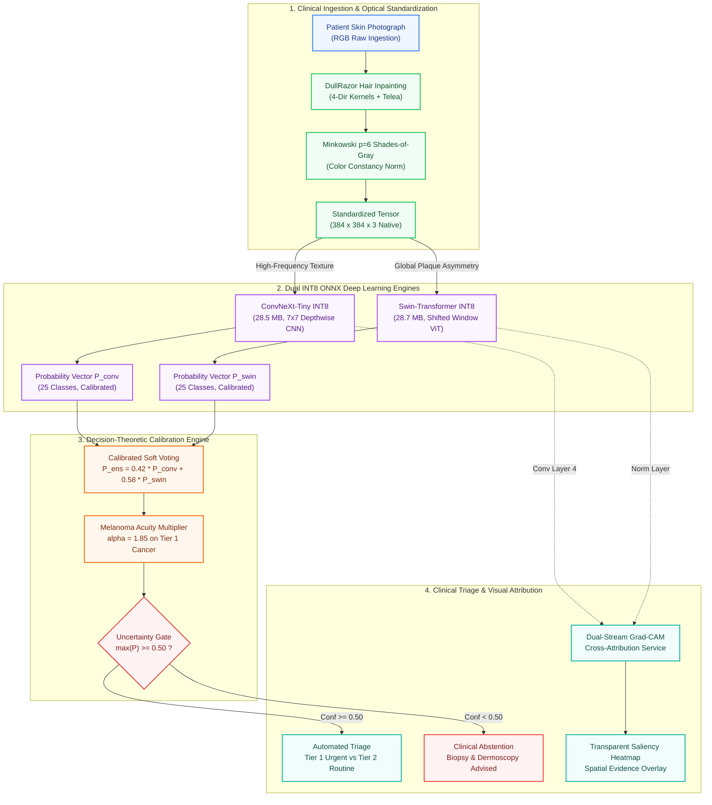
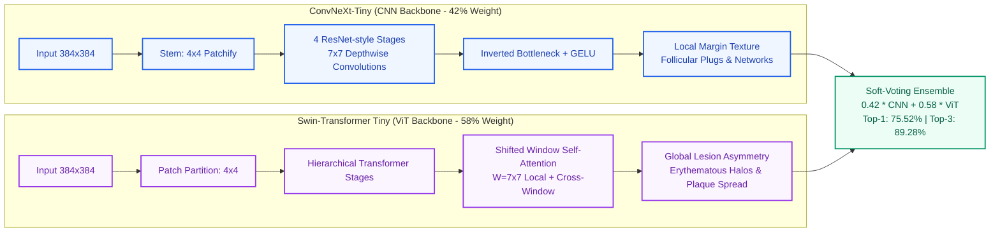
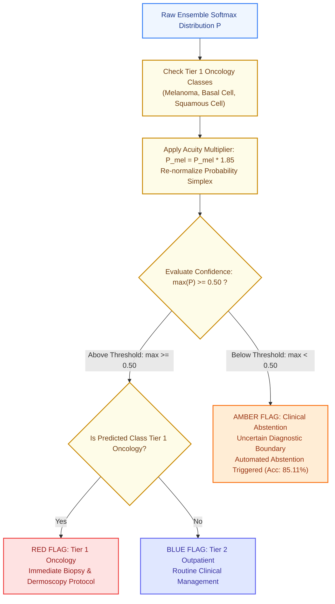

# Dermsemble Deep Learning Architecture Schematics

This directory contains standalone, reproducible Mermaid architecture diagrams for the **Dermsemble** clinical triage engine.

---

## 1. End-to-End Clinical System Pipeline
**File:** [`01_end_to_end_pipeline.mmd`](./01_end_to_end_pipeline.mmd)

---

## 2. Dual Backbone Synergy (CNN vs. Vision Transformer)
**File:** [`02_dual_backbone_synergy.mmd`](./02_dual_backbone_synergy.mmd)

---

## 3. Decision Safety Policies & Clinical Triage Tree
**File:** [`03_decision_safety_policies.mmd`](./03_decision_safety_policies.mmd)

