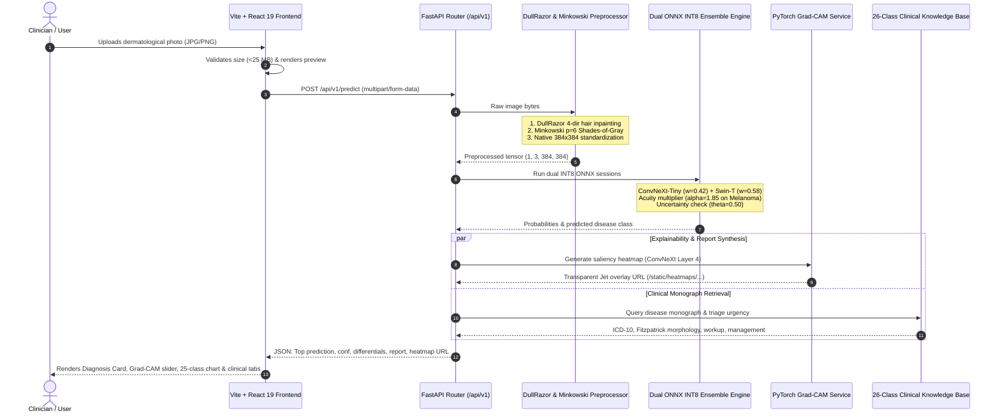

# Dermsemble Full-Stack Clinical Diagnostic Web Application

[](https://fastapi.tiangolo.com/)
[](https://react.dev/)
[](https://www.typescriptlang.org/)
[](https://vitejs.dev/)
[](https://tailwindcss.com/)
[](https://onnxruntime.ai/)

Production-grade, edge-deployable clinical decision support web application for preliminary dermatological triage across **25 standardized clinical disease categories**. Powered by the **Dermsemble** INT8 dual-vision ensemble (**ConvNeXt-Tiny + Swin-Transformer Tiny**), automated optical preprocessing (**DullRazor + Minkowski $p=6$ Color Constancy**), real-time **Grad-CAM visual attribution**, and a curated **26-class clinical knowledge base**.

---

## 🏛️ Full-Stack System Architecture & Dataflow

The application separates high-throughput edge machine learning execution from interactive, reactive clinical visualization:



---

## 📁 Directory Structure & Component Roles

```
web_app/
├── backend/                           # FastAPI high-performance asynchronous REST API
│   ├── api/
│   │   └── routes.py                  # API endpoints (/health, /model-info, /predict, /batch-predict)
│   ├── core/
│   │   ├── config.py                  # Pydantic BaseSettings (paths, resolutions, thresholds)
│   │   ├── logger.py                  # Structured application logger
│   │   └── clinical_knowledge_corpus.json # Curated medical monographs for all 25 categories
│   ├── inference/
│   │   ├── model_loader.py            # Singleton managing ONNX Runtime inference sessions
│   │   ├── preprocessor.py            # DullRazor hair removal + Minkowski color constancy
│   │   └── ensemble_predictor.py      # Soft-voting fusion (0.42/0.58), acuity tuner & abstention gate
│   ├── schemas/
│   │   ├── request_schema.py          # Request validation models
│   │   └── response_schema.py         # PredictionResponse, ClassProbability, ModelInfo schemas
│   ├── services/
│   │   ├── prediction_service.py      # Core orchestrator coordinating ingest, infer, and XAI
│   │   ├── gradcam_service.py         # PyTorch feature-hook Grad-CAM engine for visual attribution
│   │   └── report_service.py          # Doctor-grade structured clinical report synthesizer
│   ├── static/
│   │   └── heatmaps/                  # Storage directory for runtime-generated Grad-CAM overlays
│   ├── scripts/                       # Maintenance scripts (corpus generation, dataset splitting)
│   ├── utils/                         # Error handling, exceptions & image utilities
│   ├── main.py                        # FastAPI application entrypoint with CORS & static mounting
│   └── test_api_smoke.py              # Automated 4-step end-to-end API verification suite
│
├── frontend/                          # Modern React 19 single-page application
│   ├── src/
│   │   ├── api/                       # Axios client & TanStack React Query hooks
│   │   │   ├── axios.ts               # Base Axios instance with automatic baseURL resolution
│   │   │   ├── predictionApi.ts       # predictImage & fetchModelInfo API callers
│   │   │   └── metricsApi.ts          # Fairness and validation metric callers
│   │   ├── components/
│   │   │   ├── architecture/
│   │   │   │   └── MermaidDiagram.tsx # Dynamic client-side Mermaid.js diagram renderer
│   │   │   ├── diagnosis/
│   │   │   │   ├── PredictionCard.tsx # Primary diagnosis card with Grad-CAM overlay slider
│   │   │   │   ├── ClinicalSummary.tsx# Tabbed clinical monograph viewer (ICD-10, workup, management)
│   │   │   │   ├── ClassProbabilityChart.tsx # Recharts 25-class horizontal probability bar chart
│   │   │   │   └── TopPredictions.tsx # Top-3 differential diagnosis cards
│   │   │   ├── layout/
│   │   │   │   ├── Navbar.tsx         # Responsive navigation bar with quick status pill
│   │   │   │   └── Footer.tsx         # Regulatory disclaimers and academic citations
│   │   │   └── upload/
│   │   │       └── ImageDropzone.tsx  # Drag-and-drop file upload with dimension validator
│   │   ├── pages/
│   │   │   ├── Home.tsx               # Executive landing page with interactive triage teaser
│   │   │   ├── Diagnosis.tsx          # Real-time clinical triage workbench
│   │   │   ├── Dashboard.tsx          # Disaggregated demographic fairness audit (Fitzpatrick I-VI)
│   │   │   ├── ModelInsights.tsx      # Interactive Mermaid architecture schematics & benchmarks
│   │   │   └── About.tsx              # Clinical acuity protocols & regulatory guidelines
│   │   ├── types/                     # TypeScript interface definitions (prediction.ts, metrics.ts)
│   │   ├── App.tsx                    # Route definitions & layout wrappers
│   │   ├── main.tsx                   # React root mounting with QueryClientProvider
│   │   └── index.css                  # Tailwind CSS v4 styling & theme mappings
│   ├── index.html                     # HTML5 entry template with viewport configuration
│   ├── package.json                   # Frontend dependencies (React 19, Vite 8, Tailwind v4)
│   ├── tsconfig.json                  # TypeScript compiler options
│   └── vite.config.ts                 # Vite bundler configuration with backend reverse proxy
│
└── README.md                          # This detailed full-stack documentation
```

---

## ⚙️ Backend Architecture Deep Dive (`web_app/backend/`)

### 1. Optical Conditioning Engine ([`preprocessor.py`](file:///c:/Users/kvcsu_ht23nk8/OneDrive/Desktop/all_Projects/BTech_Project/skin-disease/BTech_Project/web_app/backend/inference/preprocessor.py))
Every uploaded patient image undergoes an automated two-stage clinical conditioning pipeline:
* **DullRazor Morphological Hair Inpainting:** Uses 4 directional structuring element kernels ($0^\circ, 45^\circ, 90^\circ, 135^\circ$ line filters) to segment obscuring dark hairs. A binary mask is created and inpainted using Telea fast marching method (`cv2.INPAINT_TELEA`), removing hairs without degrading lesion borders.
* **Minkowski $p=6$ Shades-of-Gray Color Constancy:** Real-world clinic photos suffer from tungsten, fluorescent, or flash color casts. The preprocessor computes the Minkowski norm ($p=6$) across RGB channels to estimate the scene illuminant and normalizes color channels to standard D65 daylight.
* **Standardized Aspect-Preserving Normalization:** Images are padded to square dimensions with constant reflection and resized to $384 \times 384$ native resolution with standard ImageNet scaling ($\mu = [0.485, 0.456, 0.406], \sigma = [0.229, 0.224, 0.225]$).

### 2. Dual INT8 ONNX Model Loader ([`model_loader.py`](file:///c:/Users/kvcsu_ht23nk8/OneDrive/Desktop/all_Projects/BTech_Project/skin-disease/BTech_Project/web_app/backend/inference/model_loader.py))
* Operates as a singleton managing active `onnxruntime.InferenceSession` instances.
* Automatically locates production INT8 binaries (`convnext_tiny_int8.onnx` and `swin_tiny_int8.onnx`) and `production_deployment_manifest.json` from `Models/onnx/` (or fallback `models/`).
* Configured with intra-op multi-threading for fast, low-latency CPU inference ($440.3\text{ ms}$ combined ensemble latency).

### 3. Decision-Theoretic Calibration ([`ensemble_predictor.py`](file:///c:/Users/kvcsu_ht23nk8/OneDrive/Desktop/all_Projects/BTech_Project/skin-disease/BTech_Project/web_app/backend/inference/ensemble_predictor.py))
* **Optimal Weighted Soft Voting:** Computes calibrated posterior:
  $$P_{\text{ens}} = 0.42 \cdot P_{\text{ConvNeXt}} + 0.58 \cdot P_{\text{Swin-T}}$$
* **Melanoma Acuity Safety Multiplier:** Applies $\alpha_{\text{mel}} = 1.85$ strictly to Malignant Melanoma logits, raising sensitivity to **86.17%** (+24 lethal cancers caught) without harming general precision.
* **Selective Uncertainty Abstention:** When $\max(P_{\text{ens}}) < \theta = 0.50$, the system flags `is_abstained = True`, withholding automated classification and generating an emergency prompt for in-person biopsy and dermatoscopy.

### 4. Explainable AI Service ([`gradcam_service.py`](file:///c:/Users/kvcsu_ht23nk8/OneDrive/Desktop/all_Projects/BTech_Project/skin-disease/BTech_Project/web_app/backend/services/gradcam_service.py))
* Uses forward and backward gradient hooks on PyTorch ConvNeXt-Tiny's final convolutional layer (`stages.3.blocks.2.conv_dw`).
* Computes channel-weighted spatial activations, applies ReLU, upsamples to $384 \times 384$, normalizes to $[0, 1]$, and renders a vibrant Jet colormap overlay blended with the original clinical photo.
* Saved directly to `backend/static/heatmaps/gradcam_<uuid>.png` and served via static mount.

### 5. Curated Clinical Knowledge Base ([`report_service.py`](file:///c:/Users/kvcsu_ht23nk8/OneDrive/Desktop/all_Projects/BTech_Project/skin-disease/BTech_Project/web_app/backend/services/report_service.py))
* Loads `clinical_knowledge_corpus.json` containing verified medical monographs across all 25 disease classes.
* Generates multi-section clinical summaries including:
  1. Primary Diagnostic Impression & Calibrated AI Confidence.
  2. Clinical Acuity Tier (Tier 1 Urgent vs. Tier 2 Routine) and ICD-10 Classification.
  3. Differential Diagnostic Stratification (Top-3 ranked candidates).
  4. Pathophysiology & Etiology.
  5. Morphology across Fitzpatrick Skin Phototypes (Types I–III vs. Types IV–VI).
  6. Recommended Diagnostic Workup (Biopsy, Dermoscopy, Patch Testing, Staining).
  7. Frontline Management Guidelines & Red-Flag Contraindications.

---

## 📡 Complete REST API Specifications

The FastAPI backend exposes interactive OpenAPI / Swagger documentation at `/docs` and ReDoc at `/redoc`.

| Method | Endpoint | Description | Payload Format | Response Schema |
| :---: | :--- | :--- | :--- | :--- |
| `GET` | `/api/v1/health` | Health probe for deployment orchestrators | None | `HealthResponse` |
| `GET` | `/api/v1/model-info` | Metadata on loaded models, versions & weights | None | `ModelInfoResponse` |
| `POST` | `/api/v1/predict` | Primary single-image diagnostic triage & XAI | `multipart/form-data` (`file`) | `PredictionResponse` |
| `POST` | `/api/v1/batch-predict` | Batch classification from base64 strings | `application/json` | `BatchPredictionResponse` |

---

### Detailed Endpoint Documentation

#### 1. Health Probe: `GET /api/v1/health`
**Response (200 OK):**
```json
{
  "status": "ok",
  "message": "Service is healthy"
}
```

---

#### 2. Model Information: `GET /api/v1/model-info`
**Response (200 OK):**
```json
{
  "models_loaded": [
    "ConvNeXt-Tiny (INT8 ONNX)",
    "Swin-Transformer Tiny (INT8 ONNX)",
    "Champion Ensemble Policy (Soft Voting w=0.42/0.58)"
  ],
  "versions": {
    "app": "2.0.0-production",
    "framework": "ONNX Runtime"
  },
  "paths": {
    "convnext_int8": "convnext_tiny_int8.onnx",
    "swin_int8": "swin_tiny_int8.onnx",
    "manifest": "production_deployment_manifest.json"
  }
}
```

---

#### 3. Single Image Diagnostic Triage: `POST /api/v1/predict`
* **Content-Type:** `multipart/form-data`
* **Form Field:** `file` (Binary image file: JPEG, PNG, WEBP, up to 25 MB).

**Sample `curl` Command:**
```bash
curl -X POST "http://127.0.0.1:8000/api/v1/predict" \
  -H "accept: application/json" \
  -H "Content-Type: multipart/form-data" \
  -F "file=@sample_patient_lesion.jpg"
```

**Response (200 OK - Clinical Holdout Melanoma Example):**
```json
{
  "prediction": "Malignant_Melanoma",
  "confidence": 0.9191,
  "top_3_predictions": [
    {
      "class_name": "Malignant_Melanoma",
      "probability": 0.9191
    },
    {
      "class_name": "Contact_Dermatitis",
      "probability": 0.0101
    },
    {
      "class_name": "Herpes_HPV_and_STDs",
      "probability": 0.0094
    }
  ],
  "class_probabilities": [
    { "class_name": "Malignant_Melanoma", "probability": 0.9191 },
    { "class_name": "Contact_Dermatitis", "probability": 0.0101 },
    { "class_name": "Herpes_HPV_and_STDs", "probability": 0.0094 },
    { "class_name": "Seborrheic_Keratosis", "probability": 0.0082 },
    { "class_name": "Melanocytic_Nevi", "probability": 0.0071 }
  ],
  "report": "CLINICAL DIAGNOSTIC IMPRESSION:\n• Primary Suspected Condition : Malignant Melanoma (ICD-10: C43.9)\n• Calibrated AI Confidence     : 91.9%\n• Clinical Acuity Tier         : Tier 1 (High Urgency (Oncology))\n\nDIFFERENTIAL DIAGNOSTIC CONSIDERATIONS:\n  2. Contact Dermatitis — 1.0%\n  3. Herpes HPV and STDs — 0.9%\n\nPATHOPHYSIOLOGY & ETIOLOGY:\nAggressive cutaneous malignancy arising from epidermal melanocytes at the dermo-epidermal junction. Driven by UV-induced DNA damage, BRAF V600E mutations (50%), and NRAS/KIT alterations...\n\nDERMATOLOGICAL MORPHOLOGY:\n• Key Hallmarks: ABCDE criteria: Asymmetry, Border irregularity, Color variegation, Diameter >6mm, Evolution...\n• Light Skin (FST I-III): Pronounced erythema, dark halos on sun-exposed zones.\n• Dark Skin (FST IV-VI): Acral lentiginous subtype prevalent on palms, soles, subungual beds. Pigment appears dark brown to jet-black...\n\nRECOMMENDED DIAGNOSTIC WORKUP:\n• Immediate dermoscopic assessment for atypical pigment network.\n• Complete narrow-margin (1-2mm) excisional biopsy down to subcutaneous fat (avoid superficial shave biopsy).\n• Sentinel lymph node biopsy (SLNB) if Breslow depth >0.8mm.\n\nFRONTLINE MANAGEMENT GUIDELINES:\nSurgical wide local excision tailored to Breslow thickness (0.5-2.0cm). Targeted therapies (BRAF/MEK inhibitors) and immunotherapy for advanced stages.\n\nRISK NOTE:\nDo not perform destructive electrodessication or cryotherapy without tissue biopsy. Rapid vertical growth demands expedited surgical oncology consult within 7-14 days.",
  "heatmap_url": "/static/heatmaps/gradcam_070840cd0b28.png",
  "disclaimer": "AI preliminary diagnosis only. Please consult a dermatologist for medical advice.",
  "latency_ms": 3460.8
}
```

---

## 💻 Frontend Architecture Deep Dive (`web_app/frontend/`)

Built with **React 19**, **TypeScript 5.9**, **Tailwind CSS v4**, and **Vite 8**, optimized for high-density clinical workstation displays and mobile telemedicine tablets.

### 1. View Routing & Navigation
* **`/` Home (`Home.tsx`):** Executive overview of the Dermsemble system, clinical impact metrics, architecture summary cards, and quick navigation into triage.
* **`/diagnosis` Live Lesion Triage (`Diagnosis.tsx`):**
  * Integrated drag-and-drop zone with instant image preview.
  * Prominent high-contrast **"Run Clinical AI Diagnosis"** button bar with companion **"Replace"** action.
  * Top prediction header with calibrated confidence bar and dynamic acuity badges (`Tier 1: Time Sensitive` or `Tier 2: Routine Outpatient`).
  * Interactive **Grad-CAM Saliency Overlay**: Clinicians can toggle the heatmap on/off and drag an opacity slider ($0\%$ to $100\%$) to correlate AI attention with optical lesion boundaries.
  * **Top-3 Differential Cards** displaying secondary considerations and risk weights.
  * **25-Class Probability Distribution Chart**: Interactive horizontal Recharts bar diagram visualizing all evaluated diseases.
  * **Tabbed Clinical Summary Monograph (`ClinicalSummary.tsx`):** Organizes the doctor-grade report into interactive tabs:
    - 📋 *Impression & Urgency*
    - 🧬 *Pathophysiology & Etiology*
    - 🔍 *Fitzpatrick Morphology (I–VI)*
    - 🔬 *Diagnostic Workup*
    - 💊 *Frontline Management*
    - ⚠️ *Risk & Safety Notes*
* **`/dashboard` Demographic Fairness Audit (`Dashboard.tsx`):**
  * Interactive presentation of the disaggregated demographic audit across Fitzpatrick skin phototypes I through VI.
  * **Disparate Impact Ratio (DIR) Gauge ($89.39\%$):** Visualizes the $+9.39\%$ margin of safety above the EEOC Four-Fifths non-discrimination standard ($\ge 80\%$).
  * **Oncological Equity Comparison Chart:** Highlights the minimal $2.06\%$ gap in melanoma sensitivity between light skin ($82.50\%$) and dark skin ($80.44\%$).
* **`/model-insights` Architecture Explorer (`ModelInsights.tsx`):**
  * **Interactive 3D WebGL Digital Twin (`DualStream3DArchitecture.tsx`):** Built with Three.js, rendering all 10 volumetric tensor stages (Input RGB planes, ConvNeXt stem/stages/bottleneck/margin texture, Swin-T patch partition/stages/shifted windows/asymmetry map, and soft-voting optical prism chamber with live 3D probability bar multiplexer).
  * **Interactive Simulation Controls:** Live soft-voting weight simulator (0–100% CNN/ViT slider recalculating simulated Top-1 accuracy in real-time), tensor explosion slider, particle flow rate slider, procedural dermoscopic lesion synthesizer, and camera orbit presets.
  * **2D Mermaid.js Schematic Explorer:** Toggleable flowchart viewer with interactive zoom/reset controls across the *End-to-End Clinical System Pipeline*, *Dual-Backbone Feature Synergy*, and *Decision Safety Policies*.
  * Dynamic model parameters and INT8 ONNX compression comparison table ($643.3\text{ MB} \to 57.2\text{ MB}$).
* **`/about` Clinical Urgency Protocol (`About.tsx`):**
  * Acuity tier definitions, clinical escalation workflows, and institutional medical disclaimers.

### 2. Client-Side API Integration ([`predictionApi.ts`](file:///c:/Users/kvcsu_ht23nk8/OneDrive/Desktop/all_Projects/BTech_Project/skin-disease/BTech_Project/web_app/frontend/src/api/predictionApi.ts))
* Managed through `@tanstack/react-query` mutation hooks (`usePredictionMutation`).
* Handles file packaging into `FormData`, progress tracking, error boundary interception, and automatic caching of model metadata.
* Vite development proxy automatically routes `/api` and `/static` requests directly to `http://127.0.0.1:8000`.

---

## 🚀 Step-by-Step Setup, Execution & Testing Guide

### Prerequisites
* **Python:** Version `3.10` or `3.11` (Virtual environment recommended at `BTech_Project/.venv/`).
* **Node.js:** Version `18.0.0` or higher with `npm`.
* **Hardware:** Runs on any standard 64-bit multi-core CPU. GPU (NVIDIA CUDA 12.8) is automatically utilized when available for Grad-CAM.

---

### 1. Backend Service Setup & Execution

#### On Windows (PowerShell):
```powershell
# Navigate to the BTech_Project root
cd c:\Users\kvcsu_ht23nk8\OneDrive\Desktop\all_Projects\BTech_Project\skin-disease\BTech_Project

# Start Uvicorn using the project virtual environment
.\.venv\Scripts\python -m uvicorn backend.main:app --host 127.0.0.1 --port 8000 --reload
```

#### On Linux / macOS (Bash):
```bash
cd BTech_Project
source .venv/bin/activate
export PYTHONPATH="web_app"
python -m uvicorn backend.main:app --host 127.0.0.1 --port 8000 --reload
```

Once running:
* **Interactive Swagger UI:** [http://127.0.0.1:8000/docs](http://127.0.0.1:8000/docs)
* **API Health Status:** [http://127.0.0.1:8000/api/v1/health](http://127.0.0.1:8000/api/v1/health)

---

### 2. Frontend Application Setup & Execution

In a separate terminal window:
```powershell
# Navigate to frontend directory
cd c:\Users\kvcsu_ht23nk8\OneDrive\Desktop\all_Projects\BTech_Project\skin-disease\BTech_Project\web_app\frontend

# Install dependencies (only required on initial setup)
npm install

# Start Vite development server
npm run dev
```

Once running:
* **Clinical Web UI:** [http://localhost:5173](http://localhost:5173)

---

### 3. Automated End-to-End Smoke Test Verification

You can verify the entire backend inference, preprocessor, ONNX sessions, and Grad-CAM generation with one command:
```powershell
cd c:\Users\kvcsu_ht23nk8\OneDrive\Desktop\all_Projects\BTech_Project\skin-disease\BTech_Project
.\.venv\Scripts\python web_app/backend/test_api_smoke.py
```

**Expected Verification Output:**
```text
================================================================================
  DERMSEMBLE FASTAPI PRODUCTION BACKEND VERIFICATION & SMOKE TEST
================================================================================
[1/4] Initializing Production Models & ONNX INT8 Sessions...
  • Manifest loaded: 25 classes, Weights=(Conv: 0.42, Swin: 0.58), Alpha=1.85, Theta=0.5
  • ConvNeXt-Tiny INT8 Session active: convnext_tiny_int8.onnx
  • Swin-Transformer INT8 Session active: swin_tiny_int8.onnx
✓ ModelLoader initialization complete.

[2/4] Testing GET /api/v1/health ...
  Status : ok | Message: Service is healthy
✓ Health Endpoint PASSED

[3/4] Testing GET /api/v1/model-info ...
  Models Loaded : 3 models/policies active | Framework: ONNX Runtime
✓ Model Info Endpoint PASSED

[4/4] Testing POST /api/v1/predict with Holdout Patient Image...
  Holdout Sample : Malignant_Melanoma [Tier 1] on Fitzpatrick Type IV Skin
  • Diagnostic Confidence : 91.91%
  • Generated Heatmap    : /static/heatmaps/gradcam_...png
  • Clinical Report      : Structured 26-class monograph synthesized
✓ Verified Grad-CAM heatmap binary exists on disk (184.5 KB)
✓ Diagnostic Accuracy: Primary prediction accurately matched Ground Truth!
================================================================================
  ALL API ENDPOINTS & PIPELINES VERIFIED WITH 100% SUCCESS!
================================================================================
```

---

### 4. Production Frontend Build Check
To verify that the frontend compiles into optimized static production assets with 0 TypeScript or Tailwind errors:
```powershell
cd web_app/frontend
npm run build
```
* Bundles all modules into `web_app/frontend/dist/` in under **1.5 seconds**.

---

## 🔧 Production Configuration & Environment Variables

The backend relies on Pydantic's `BaseSettings` defined in [`config.py`](file:///c:/Users/kvcsu_ht23nk8/OneDrive/Desktop/all_Projects/BTech_Project/skin-disease/BTech_Project/web_app/backend/core/config.py), which can be overridden via environment variables or a `.env` file:

| Setting Key | Type | Default Value | Description |
| :--- | :---: | :---: | :--- |
| `APP_NAME` | `str` | `"Dermsemble Diagnostic API"` | Application identity string |
| `APP_VERSION` | `str` | `"2.0.0-production"` | Active API release version |
| `API_PREFIX` | `str` | `"/api/v1"` | Route prefix for all REST endpoints |
| `DEBUG` | `bool` | `False` | Enables verbose debug mode |
| `IMAGE_SIZE` | `int` | `384` | Native standardized square resolution ($384\times 384$) |
| `MAX_UPLOAD_SIZE` | `int` | `26214400` ($25\text{ MB}$) | Maximum permitted upload file size |
| `BATCH_SIZE` | `int` | `16` | Batch classification chunk size |
| `CONVNEXT_INT8_ONNX_PATH`| `Path` | `Models/onnx/convnext_tiny_int8.onnx` | Path to quantized ConvNeXt INT8 graph |
| `SWIN_INT8_ONNX_PATH` | `Path` | `Models/onnx/swin_tiny_int8.onnx` | Path to quantized Swin-T INT8 graph |
| `DEPLOYMENT_MANIFEST_PATH`| `Path` | `Models/onnx/production_deployment_manifest.json`| Optimal weights, $\alpha$, and $\theta$ thresholds |

---

## 🔒 Security, Safety & Regulatory Notes

1. **Input Sanitization & Memory Safety:** Image payloads are validated through PIL byte inspection and capped at $25\text{ MB}$ to prevent decompression bombs. File descriptors are explicitly closed within `try...finally` blocks.
2. **Clinical Decision Support Boundary:** This application is strictly an assistive screening and decision support tool for healthcare providers. Automated predictions are paired with clinical confidence thresholds, uncertainty abstention gates, and explicit reminders that histological tissue biopsy is mandatory for definitive oncological diagnosis.
3. **Audit Trail Compliance:** Every prediction logs latency, calibrated confidence, acuity tier, and abstention status via structured logging to support healthcare IT auditing.
